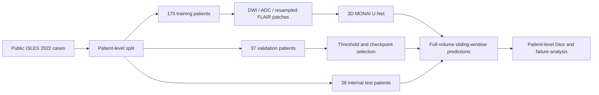

# ISLES 2022 Stroke MRI Segmentation

A research and learning project for ischemic stroke lesion segmentation using a **MONAI 3D U-Net with DWI, ADC, and FLAIR MRI inputs**. The repository documents a patch-based training workflow and patient-level, full-volume evaluation on an internal split of the public ISLES 2022 dataset.

**Status:** notebook-based research prototype. All reported model-performance scores are **historical outputs saved in the notebook, not independently reproduced or verified**. This project is not a clinical device and has not established diagnostic or deployment readiness.

[Clinical motivation](#clinical-motivation) · [Dataset](#dataset-and-attribution) · [Methodology](#methodology) · [Results and verification status](#historical-reported-results) · [Reproduction](#setup-and-execution) · [Limitations](#reproducibility-status-and-limitations)

## Clinical motivation

Ischemic stroke can produce lesions that vary substantially in size and location. Delineating their extent on MRI supports research into lesion burden and anatomical distribution, but expert annotation is time-consuming and small lesions can be difficult to segment consistently. This project explores whether a three-dimensional segmentation network can learn complementary MRI signals to approximate expert lesion masks.

The task is **voxel-level lesion delineation**, rather than stroke diagnosis, treatment selection, or outcome prediction. Its portfolio contribution is a documented multimodal research workflow with patient-level evaluation, explicit geometry assumptions, and failure analysis. Clinical usefulness would require evidence beyond overlap with retrospective annotations, including external and prospective evaluation.

| Input channel | MRI information | Role in this experiment |
| --- | --- | --- |
| DWI — diffusion-weighted imaging | Diffusion-sensitive signal; acute ischemic lesions can appear hyperintense | Reference voxel grid and first model channel |
| ADC — apparent diffusion coefficient | Quantifies diffusion; restricted diffusion can have reduced ADC | Complementary diffusion information, checked against the DWI grid |
| FLAIR — fluid-attenuated inversion recovery | T2-weighted tissue signal with cerebrospinal-fluid suppression | Additional tissue context, resampled to the DWI grid |

These are scientific motivations for the inputs, not proof that this model gains accuracy from each modality; modality ablations have not been reported.

## Repository contents

```text
README.md                              Research documentation
ISLES_2022_First_Colab_Notebook.ipynb   Data exploration, preprocessing, training,
                                       validation, internal testing, and figures
.gitignore                             Git exclusion rules
isles2022/                             Reusable model configuration, model builder,
                                       and patient-level Dice metric helpers
evaluation/                            Physical-volume, zero-overlap, and bootstrap utilities
pyproject.toml                         Package metadata and unpinned dependencies
tests/                                 Synthetic model, evaluation, and checkpoint-selection tests
```

The notebook implements the end-to-end experiment. The `isles2022` package supplies reusable model configuration, a MONAI model builder, and patient-level Dice helpers; synthetic tests cover those components. The standalone `evaluation/` utilities add physical lesion volume in mL, complete zero-overlap detection, and patient-level bootstrap intervals; see [usage and assumptions](evaluation/USAGE.md). They do not load historical results or run inference, and are not wired into the notebook. The notebook still defines its own training and evaluation code. There is no command-line inference tool, pinned dependency environment, or CI workflow. Checkpoints, split JSON files, evaluation CSVs, and standalone figures generated by the notebook are not included in this repository.

## Dataset and attribution

The workflow uses the public **250-case ISLES 2022 dataset**, with diffusion-weighted imaging (DWI), apparent diffusion coefficient (ADC), fluid-attenuated inversion recovery (FLAIR), and expert ischemic lesion masks.

- Dataset record and download: [Zenodo record 7960856](https://zenodo.org/records/7960856).
- Dataset publication: Hernandez Petzsche et al., *ISLES 2022: A multi-center magnetic resonance imaging stroke lesion segmentation dataset*, **Scientific Data** (2022). [DOI: 10.1038/s41597-022-01875-5](https://doi.org/10.1038/s41597-022-01875-5).
- The notebook retrieves `ISLES-2022.zip` through the Zenodo API. Its saved output reports 1,692,717,470 bytes (approximately 1.69 GB decimal / 1.58 GiB).

Download data from the official source and consult that record and the archive's `LICENSE` for the applicable data-use and attribution terms before use or redistribution. The dataset is not distributed in this repository. Dataset terms are separate from software licensing; this repository currently has no code license file.

The expected extracted structure includes:

```text
ISLES-2022/
  sub-strokecaseXXXX/ses-0001/
    dwi/sub-strokecaseXXXX_ses-0001_dwi.nii.gz
    dwi/sub-strokecaseXXXX_ses-0001_adc.nii.gz
    anat/sub-strokecaseXXXX_ses-0001_FLAIR.nii.gz
  derivatives/sub-strokecaseXXXX/ses-0001/
    sub-strokecaseXXXX_ses-0001_msk.nii.gz
```

## Setup and execution

The supported workflow described by the notebook is **Google Colab with Google Drive**. These instructions describe the existing implementation; they are not a freshly tested reproduction recipe.

1. [Open the notebook in Colab](https://colab.research.google.com/github/sbmedtech/isles2022-stroke-mri-segmentation/blob/main/ISLES_2022_First_Colab_Notebook.ipynb) and save a working copy.
2. Select a GPU runtime where available. Historical output identifies a Tesla T4. The code can select CPU when CUDA is unavailable, but full training on CPU has not been validated here.
3. Review the execution and checkpoint-selection caveats below before running cells in order. The notebook installs `nibabel`, `scipy`, `matplotlib`, `tqdm`, and `monai`; it also uses `numpy`, `torch`, `requests`, and `pandas` from the runtime. Versions are not pinned, and compatibility with a future Colab environment is not guaranteed.
4. Mount Google Drive when prompted. Persistent project files use `/content/drive/MyDrive/ISLES2022_Project`, including `data/`, `models/`, `results/`, and `splits/`. Preprocessed training and validation tensors use the temporary local cache `/content/isles2022_preprocessed`.
5. Allow space for the approximately 1.69 GB archive, extracted NIfTI files, tensor cache, checkpoints, and results. The notebook contains disk-space inspection cells; a minimum RAM, VRAM, storage budget, and end-to-end runtime have not been established.
6. Download and extract the official archive using the notebook cells. Downloads are checked against the byte size in Zenodo metadata; cryptographic checksum verification is not implemented. If a download fails, consult the official record and the paths expected by the notebook.
7. Continue through patient discovery, preprocessing checks, patch sampling, training, validation, and internal test evaluation. Checkpoint and resume cells rely on files generated by earlier cells.

**Execution caveats:** rerunning the initial training cell resets its training history and can overwrite the latest checkpoint. A diagnostic loss/backpropagation cell also performs an optimizer update before the counted training epochs. Cache reuse checks file existence rather than preprocessing provenance. Inspect existing artifacts before rerunning cells. Local cache files may disappear when a Colab runtime ends.

### Reusable components

The package declares Python `>=3.10` and `numpy>=1.22` plus unpinned `torch` and `monai` dependencies; the `test` extra supplies NiBabel and wheel-building tools. From a clone of this repository, a suitable local Python environment can install the components and run the existing synthetic tests with:

```bash
python -m pip install -e ".[test]"
python -m unittest discover -s tests -v
```

Both `isles2022` and `evaluation` are included in installed wheels; usage for scientific utilities is in [evaluation/USAGE.md](evaluation/USAGE.md). These commands cover the extracted components and synthetic checkpoint-selection control flow, not end-to-end notebook execution or reproduction of historical trained weights. The synthetic suite and built-wheel import check passed in the environment recorded below; clean dependency resolution and end-to-end Colab execution were not tested. The model test uses a synthetic checkpoint, not the historical epoch-43 checkpoint.

A local Jupyter environment requires adaptation of Colab-specific mounting and hard-coded paths; no portable local installation procedure is supplied. The current preprocessing function requires an expert mask, so this notebook does not provide standalone inference for unlabeled scans.

## Methodology



The diagram describes the intended experimental workflow. The checkpoint-selection audit caveat below applies to its selection step.

### Patient split

Sorted patient identifiers are shuffled with Python random seed `42` and divided into **175 training, 37 validation, and 38 internal test patients**. Assertions check pairwise split disjointness. The split manifest is saved to Google Drive as `splits/patient_splits.json`, not committed to this repository.

These are internal partitions of the public dataset, **not the official hidden ISLES challenge test set**. Training uses only training patients. The notebook caches training and validation cases, checks that the cache list excludes test cases, and preprocesses internal test cases during final evaluation.

### Preprocessing and spatial assumptions

- DWI is the reference grid. ADC and expert masks must match DWI shape and affine; mismatches raise an error in the reusable preprocessing function.
- FLAIR is resampled to the DWI grid using NiBabel affine-based resampling with linear interpolation. **Resampling is not an independently estimated anatomical registration**, and matching grids do not guarantee correct anatomical alignment.
- Each modality is normalized independently using the mean and standard deviation of nonzero voxels. Nonfinite intensities are replaced with zero; empty images return zeros and the standard deviation has a lower bound of `1e-8`.
- Input tensors have channel order **DWI, ADC, FLAIR** and shape `(3, X, Y, Z)`. Expert masks are binarized as values greater than zero and have shape `(1, X, Y, Z)`.
- Training uses `(64, 64, 32)` voxel patches. Small volumes are padded, and identical crops are applied to images and labels. Sampling alternates lesion-centered and randomly positioned patches; random patches can contain lesions. Empty masks fall back to random sampling.

No uniform physical voxel-spacing resampling is implemented in this preprocessing function. A fixed voxel patch can therefore cover different physical extents across cases.

### Model and training

| Component | Implemented setting |
| --- | --- |
| Network | MONAI `UNet`, 3D, three input channels, one output logit channel |
| Feature channels | `(16, 32, 64, 128)` |
| Strides / residual units | `(2, 2, 2)` / `2` |
| Loss | `DiceCELoss(sigmoid=True, squared_pred=False)`, equal Dice and cross-entropy weights |
| Optimizer | AdamW, learning rate `1e-4`, weight decay `1e-5` |
| Batch size | `2` |
| Sampling schedule | Two patches per patient per epoch for the first 3 epochs; four for epochs 4–43 |
| Training schedule | Initial 3 epochs, continuation to 23, then continuation to 43 |
| Final-stage validation | Epochs 28, 33, 38, and 43, compared with the epoch-23 baseline |

Checkpoints store the epoch, model and optimizer state dictionaries, and training history. They do not store the full experiment configuration or random-generator states. Initial Python, NumPy, and PyTorch seeds are set, but exact deterministic training or restart equivalence is not established.

### Inference and evaluation

Full-volume inference uses MONAI `sliding_window_inference` with ROI `(64, 64, 32)`, sliding-window batch size `1`, overlap `0.25`, and output accumulation on CPU. A sigmoid converts logits to probabilities.

At epoch 23, thresholds from `0.05` to `0.50` were compared on validation patients. Threshold **0.25** was selected using mean Dice among lesion-positive validation cases and retained for subsequent validation and internal testing. The historical workflow intended to select the best final-stage checkpoint by validation mean Dice; saved output identifies epoch **43**. Agent 4's audit found that the baseline and existing history/checkpoints were not reliably associated with the active run. The repair below corrects that control flow and adds synthetic regression coverage; real-data verification is still required.

Dice is computed per patient over the full volume as `2 × intersection / (predicted voxels + expert voxels)`. Both-empty masks receive Dice `1.0` in the implementation. Primary mean and median Dice summaries exclude expert-empty cases, whose false-positive predictions are reported separately. Cases with empty predictions are not equivalent to all segmentation failures: a nonempty prediction can still have no overlap with the lesion.

## Historical reported results

### Verification status

| Evidence category | What is available | What it establishes |
| --- | --- | --- |
| Historical model performance | Saved notebook validation/test outputs below | A record of the original experiment; scores are not independently reproduced |
| Agent 4's component audit at `a29b166` | 19 synthetic repository tests passed; synthetic U-Net state-dict and forward-output parity checked | Component behavior and architecture preservation, not performance of the historical trained checkpoint |
| Results verified after the checkpoint-selection fix | **None available in the reviewed repository** | No corrected validation/test score or validated checkpoint can be claimed |

The reviewed baseline is [commit a29b166](https://github.com/sbmedtech/isles2022-stroke-mri-segmentation/commit/a29b1662f8e6affebb1b30a213a5734bd9f2487b). That baseline contains the checkpoint-selection issue identified by the audit. This branch repairs selection and verifies it synthetically; it does not establish corrected real-data scores. When a measured rerun becomes available, publish its commit, checkpoint identity, split, threshold, environment, and evaluation artifacts in a separate verified-results entry. **Do not relabel the historical numbers as post-fix results.**

The audit passed synthetic compatibility checks with a synthetic checkpoint, not the absent historical epoch-43 checkpoint. It did not run real-data training, Colab/GPU execution, or external validation.


**Source: saved notebook outputs only. No independent execution, checkpoint validation, or metric reproduction has been performed for these reported results.**

| Evaluation | Population | Mean Dice | Median Dice | Lesion-positive cases with empty predictions |
| --- | --- | --- | --- | --- |
| Epoch-23 validation, threshold 0.25 | 36 lesion-positive of 37 validation patients | 0.5219 | 0.6230 | 2 / 36 |
| Best recorded validation, epoch 43, threshold 0.25 | 36 lesion-positive of 37 validation patients | 0.5991 | 0.6578 | 1 / 36 |
| Internal test, epoch-43 checkpoint, threshold 0.25 | 37 lesion-positive of 38 test patients | 0.5377 | 0.5818 | 2 / 37 |

The saved worst-case listing contains five lesion-positive zero-Dice cases, while the empty-prediction count is two. Empty predictions and nonempty predictions with zero overlap are distinct failure categories. The standalone `zero_overlap` utility can identify both; it has not generated a new result table for this experiment.

At epoch 43, the single expert-empty validation case had a false-positive prediction. The single expert-empty internal test case had no predicted lesion. These sample sizes do not support a reliable specificity estimate. Confidence intervals, repeated-seed variability, lesion-wise sensitivity/precision, and physical-volume error are not reported.

### Segmentation visualizations and error analysis

The notebook displays DWI, expert masks, and predicted masks for a high-performing test case (Dice approximately `0.869`) and a missed infarct (Dice `0.000`). It also includes code to generate a PDF for all 38 internal test patients and a lesion-size-versus-Dice scatter plot. Saved output reports Spearman correlation `0.510` across the 37 lesion-positive test cases, using expert lesion size in **voxels**, not physical volume.

Visualization backgrounds are normalized DWI from preprocessing. Panels are rotated identically for display, but this does not establish standardized anatomical orientation. For lesion-positive cases, the displayed slice is selected by maximum expert lesion area; the reported Dice is full-volume Dice. The all-patient PDF handles expert-empty cases using the largest predicted slice or the middle slice when both masks are empty.

The generated PDF, scatter-plot PNG, and evaluation CSVs are saved outside the repository. No downloadable standalone figures or result artifacts are supplied here. The notebook's best-case metric listing includes a both-empty case with Dice `1.0`; that case should not be interpreted as successful infarct delineation.

For environment reporting and opt-in seeding helpers, see [docs/REPRODUCIBILITY.md](docs/REPRODUCIBILITY.md).

## Checkpoint-selection repair and legacy runs

Step 14 now persists its validation-selected threshold with the exact epoch-23 checkpoint it evaluated. Step 16 measures that checkpoint instead of inserting historical scores, overwrites stale baseline/best artifacts when starting a new selection, and stores selection history, a unique run ID, threshold, weight digest, and context digest in each checkpoint. The context covers split order, train/validation cache content, preprocessing and sampling source, architecture, loss/optimizer settings, inference settings, and MONAI/PyTorch versions. Existing CSVs do not select weights. Resume remeasures the matching best checkpoint and rejects missing or mismatched provenance. Final test evaluation and prediction figures consume the checkpoint threshold; test filenames use the selected epoch.

For legacy artifacts, preserve a backup of your Drive project before migration. Restore the actual epoch-23 checkpoint as `models/checkpoint_latest.pt`, load its weights, rerun validation threshold selection (Step 14), then start Step 16. Legacy checkpoints after epoch 23 cannot establish experiment lineage and are rejected for selection resume; no historical score is used as a substitute. If epoch-23 weights are unavailable, rerun training in a separate project directory. Historical outputs in this document remain saved evidence from the original implementation; this repair has not reproduced them.

Synthetic checks passed on Python 3.12, PyTorch 2.14.1+cpu, MONAI 1.6.1, NumPy 2.5.4, and NiBabel 5.4.2. This is a recorded test environment, not a pinned training environment or a guarantee of compatibility with historical weights.

## Reproducibility status and limitations

### Checkpoint-selection audit findings

At the audited baseline, the notebook seeded epoch-23 validation history with fixed Dice values (`0.521933` and `0.622956`) instead of measuring the restored baseline model. It could reuse saved validation history and best-checkpoint files without establishing that they belong to the same experiment. A new run could therefore select or retain weights based on another run's metrics. This is a code-path finding, not evidence that the historical scores themselves are fabricated or incorrect.

The audit also found that the baseline did not propagate validation `best_threshold` and used epoch-43 artifact names. This repair propagates the selected threshold and derives test filenames/PDF epochs from the checkpoint; historical example captions are retained. A trustworthy rerun must verify actual checkpoint/epoch identity and threshold provenance rather than infer them from artifact names.

### Reproduction acceptance criteria

Following the notebook is an attempt to rerun the workflow; it is not a guarantee of reproducing its scores. Before calling a result verified after the fix:

1. Identify the fix commit and record the data checksum, exact patient split, environment versions, seeds, and preprocessing configuration.
2. Recompute baseline validation metrics from the actual restored weights and associate each metric/history file with its experiment and checkpoint.
3. Record the validation-selected threshold and selected checkpoint's hash and actual epoch; verify that final inference uses those settings.
4. Evaluate the predefined internal test cohort without tuning on its results. If the already inspected test cases inform further development, disclose that exposure and use a new prespecified evaluation design.
5. Publish per-patient metrics, population definitions, commands, and figures with provenance. Report empty predictions and complete zero-overlap failures separately; derive physical volume from native mask geometry.
6. Separate synthetic test verification from real-data performance verification. Record differences from historical outputs rather than silently replacing them.

These are real-data reproduction acceptance criteria; synthetic regression tests alone do not fulfill them.


The notebook records a research workflow and historical outputs, but **the repository alone is insufficient to reproduce the reported numerical results with confidence**.

- Dependencies are unpinned and execution relies on Colab state, sequential cells, and personal Drive paths.
- Exact split manifests, checkpoints, metric CSVs, and standalone figures are not released here.
- Random-generator states are not saved, and deterministic resume behavior is not verified. Step 16 fingerprints the cached train/validation tensors and selection context to reject mismatched selection resumes; cache creation itself still trusts file existence.
- Synthetic tests exist for the extracted model and Dice helpers, alongside notebook assertions and manual checks. Synthetic selection/resume regression tests cover Step 16; full preprocessing, end-to-end training/resume, GPU inference coverage, and CI remain absent.
- Affine-based FLAIR resampling may leave anatomical misalignment; automated registration-quality assessment is absent.
- Only one internal random patient split is reported. No center-held-out or external validation establishes generalization to new scanners, institutions, or clinical populations.
- Small-lesion failures appear in saved outputs. Mean Dice alone does not establish lesion detection reliability or clinical utility.
- Lesion size is analyzed in voxels, which can differ in physical volume across acquisitions. Standalone physical-volume and patient-bootstrap functions exist, but corresponding patient results, intervals, surface-distance metrics, and lesion-wise metrics are not reported.
- Validation data were used for threshold and checkpoint selection; validation scores are selection-dependent. Internal test results should not guide subsequent tuning while still being described as an untouched test estimate.
- No clinical reader study, prospective evaluation, calibrated uncertainty analysis, or diagnostic-use validation is provided.

## Future work

1. Verify corrected checkpoint/metric/threshold association on real data, then release a versioned experiment configuration, patient split manifest, environment specification, checkpoint with checksum, and evaluation artifacts where permitted; independently rerun the documented workflow.
2. Consolidate the existing model and metric components and extract reusable preprocessing, training, and inference modules with configurable paths. Provide mask-free inference and spatially faithful NIfTI export.
3. Extend the existing synthetic model/metric tests with NIfTI geometry, normalization, patch sampling, split integrity, training/resume, and sliding-window inference coverage; run lightweight checks in CI.
4. Assess anatomical alignment and acquisition-center effects. Compare modality ablations and suitable baselines under the same evaluation protocol.
5. Report patient-level uncertainty intervals, lesion-wise detection metrics, physical-volume error, and small-lesion performance; add representative and failure overlays with verified orientation.
6. Seek center-held-out or external validation and publish a model card, measured resource requirements, and explicit intended-use boundaries.

These are proposed improvements, not capabilities or artifacts currently supplied by the repository.
