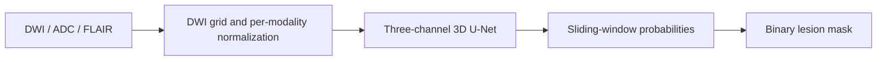

# ISLES 2022 · Stroke MRI Segmentation

A **3D U-Net for ischemic stroke lesion segmentation** using DWI, ADC and FLAIR MRI.
Expert lesion delineation supports research into stroke burden and anatomy, but
manual annotation is time-consuming and small lesions are challenging. This project
uses complementary MRI signals to approximate expert masks for research.

## Real MRI segmentation: success and failure


**Top:** case 0237, full-volume Dice **0.869**. **Bottom:** case 0115, Dice **0.000**,
a missed lesion with 15 expert-labeled voxels. Columns show normalized DWI, expert
annotation in red, and prediction in green. The displayed slice has the largest
expert lesion area; scores describe the whole 3D volume. These are unchanged
**historical notebook outputs**, not newly generated predictions. The saved
“Original DWI” label means normalized DWI; the success/failure selection is illustrative.

MRI/annotations: Hernandez Petzsche et al., **ISLES 2022**, [Zenodo](https://zenodo.org/records/7960856),
[CC BY 4.0](https://creativecommons.org/licenses/by/4.0/). Normalization and overlays
come from this repository's experiment. [Figure sources, attribution and evidence](docs/portfolio/figures-and-results.md).

## Technologies

**Python · PyTorch · MONAI · 3D U-Net · NiBabel**

NumPy/SciPy support image processing; Matplotlib supports overlays and failure
analysis. Google Colab provides the notebook workflow.

## Dataset and model

The public **ISLES 2022 dataset contains 250 expert-annotated stroke MRI cases**.
Images and lesion masks use NIfTI/BIDS-style files. Scans come from multiple centers
and are released in native space, without prior registration.

| Input | Contribution | Handling |
| --- | --- | --- |
| DWI | Diffusion-sensitive signal; ischemic lesions can appear bright | Reference voxel grid, channel 0 |
| ADC | Complementary information about restricted diffusion | DWI shape/affine checks, channel 1 |
| FLAIR | Additional tissue context | Affine-based resampling to DWI, channel 2 |

Each modality is normalized over nonzero voxels. **Resampling puts FLAIR on the
DWI grid; it does not estimate anatomical registration.** No modality ablation
establishes each input's added value.



The MONAI U-Net has feature channels `(16, 32, 64, 128)`, strides `(2, 2, 2)`,
two residual units per level, and one output logit channel (**1,187,546 parameters**).
Training uses `64 × 64 × 32` voxel patches, alternating lesion-centered and random
sampling, Dice + cross-entropy loss, and AdamW (`lr=1e-4`, `weight_decay=1e-5`).
Full-volume inference uses overlapping patches and sigmoid probabilities.

**Patient-level methodology:** the fixed seed-42 split is **175 training / 37
validation / 38 internal test patients**, separated before patch sampling. Training
uses training patients; threshold/checkpoint selection uses validation patients.
The historical experiment retained threshold **0.25** after the epoch-23 validation
sweep and reported its epoch-43 checkpoint. This is an internal split of the public
training dataset, **not the hidden challenge test set**. The original validation
checkpoint-to-threshold association remains unresolved.

Dataset publication: Hernandez Petzsche et al., *Scientific Data* (2022),
[doi:10.1038/s41597-022-01875-5](https://doi.org/10.1038/s41597-022-01875-5).
The current record also requests de la Rosa et al., *DeepISLES*, *Nature Communications*
16, 7357 (2025). That separate model's clinical validation does not apply to this project.

## Internal test results and limitations

**Historical notebook results — not independently reproduced by these reviewers.**
The primary Dice summary includes **37 lesion-positive patients out of 38 total**.

| Metric | Historical result |
| --- | --- |
| Mean full-volume Dice, lesion-positive cohort | **0.5377** |
| Median full-volume Dice, lesion-positive cohort | **0.5818** |
| Lesion-positive patients with empty predictions | **2 / 37** |
| Expert-empty patients with any false-positive prediction | **0 / 1** |

The owner reports exact replication across 38 cases; the full comparison records
remain reviewer-unverified. Released-checkpoint compatibility has been checked,
but does **not** establish numerical reproduction or original threshold/training
lineage. Selection/artifact fixes have synthetic coverage; no post-fix real-data
scores are claimed. [Evidence status](docs/portfolio/figures-and-results.md#results-and-verification-status).

- Small-lesion failures remain visible. The saved ranking includes five zero-Dice
  positive cases; empty predictions alone undercount complete overlap failures.
- One expert-empty test case cannot establish specificity. Confidence intervals,
  lesion-wise detection metrics and physical-volume error are not reported.
- Native spacing varies, and affine resampling may leave anatomical misalignment.
  Display rotation does not establish standardized anatomical orientation.
- One internal split, inspected test examples and validation-based selection limit
  generalization claims. Do not tune on these test cases and call them untouched.
- There is **no external/prospective validation or demonstrated clinical readiness**.
  Exact deterministic training/resume and the historical full environment are not established.

[Complete methods, audit history and migration caveats](docs/methodology-and-audit.md)
remain available; [figure/results evidence](docs/portfolio/figures-and-results.md)
separates historical outputs, owner reports and reviewed compatibility.

## Pretrained Model

[GitHub Release: **model-v0.1.0-preview**](https://github.com/sbmedtech/isles2022-stroke-mri-segmentation/releases/tag/model-v0.1.0-preview)
· [Download **checkpoint_best_validation.pt**](https://github.com/sbmedtech/isles2022-stroke-mri-segmentation/releases/download/model-v0.1.0-preview/checkpoint_best_validation.pt)

This epoch-43 checkpoint is a **research artifact, not a clinically validated model**.
The released file's SHA-256 is
`dd6ae8182a9af708662ad43e460459ef3deb3f89e70cc585ee9750d91755b70d`.
After installing the package below and downloading the trusted release asset to
your working directory, construct the repository's MONAI U-Net and load its weights:

```python
import torch
from isles2022.model import build_model

checkpoint = torch.load(
    "checkpoint_best_validation.pt", map_location="cpu", weights_only=True
)
model = build_model()
model.load_state_dict(checkpoint["model_state_dict"], strict=True)
model.eval()
```

The file is a checkpoint dictionary, not a standalone model or raw state dict.
This example loads compatible weights; it does not preprocess MRI, select a threshold,
or establish clinical performance. This legacy asset lacks the selection/run metadata
required by the repaired selection-resume and final-evaluation paths; loading its
weights does not make it acceptable to those paths. Historical threshold **0.25**
is not embedded with verified selection provenance in the released checkpoint. Do not infer a
validated threshold or a weight license from the filename or MIT code license.
[Checkpoint evidence and limitations](docs/portfolio/figures-and-results.md#results-and-verification-status).

## Explore in Google Colab

[**Open the portfolio notebook in Colab**](https://colab.research.google.com/github/sbmedtech/isles2022-stroke-mri-segmentation/blob/main/notebooks/ISLES_2022_Portfolio.ipynb)
· [View notebook](notebooks/ISLES_2022_Portfolio.ipynb)

Start by reading the labeled historical results and MRI figures. To run a new
experiment, save a working copy, review the execution guide, and use a separate
Drive project/cache. Training cells can overwrite checkpoints, and legacy runs
require migration. The dataset archive is approximately **1.69 GB**, before extraction.
[Notebook guide](notebooks/PORTFOLIO_GUIDE.md) · [Execution/reproduction details](docs/REPRODUCIBILITY.md).

<a name="checkpoint-selection-repair-and-legacy-runs"></a>
[Legacy checkpoint migration](docs/methodology-and-audit.md#checkpoint-selection-repair-and-legacy-runs)
is documented separately; old filenames do not establish selection provenance.

## Local setup and repository

For reusable components and synthetic checks (Python **>=3.10**, reference CPU
checks use 3.12), from an isolated environment:

```bash
git clone https://github.com/sbmedtech/isles2022-stroke-mri-segmentation.git
cd isles2022-stroke-mri-segmentation
python -m venv .venv
source .venv/bin/activate
python -m pip install torch --index-url https://download.pytorch.org/whl/cpu
python -m pip install -e '.[test,notebook]'
python -m pip check
python -m unittest discover -s tests -v
```

The CPU install is for local component checks; retain Colab's CUDA PyTorch for GPU
work. This is not a historical environment lock or a guarantee of matching training
results. The package exposes model/metric/reproducibility helpers and scientific
`evaluation` utilities; it does **not** provide a standalone inference/training CLI.
Reading saved results needs no dataset; the full experimental workflow uses expert
labels. Get data from official Zenodo; do not commit scans, weights or local caches.

```text
notebooks/          Portfolio notebook and execution guide
isles2022/          Model, Dice and reproducibility helpers
evaluation/         Volume, zero-overlap and patient-bootstrap utilities
tests/              Synthetic correctness and provenance checks
assets/portfolio/   Real historical MRI figure
docs/               Methods, evidence, licensing and audit detail
requirements/       Observed CPU direct pins, not a transitive lock
LICENSE             MIT license for original project code
```

## Licensing

Original project code is [MIT licensed](LICENSE), copyright **2026 Shreyas Bharadwaj**.
ISLES data and the underlying MRI/annotations in the displayed figure retain their
separate **CC BY 4.0** attribution requirements. Third-party libraries retain their
own licenses; the source-code license does not grant rights to pretrained weights.
See [ownership, dataset and third-party notices](docs/LICENSING.md).
