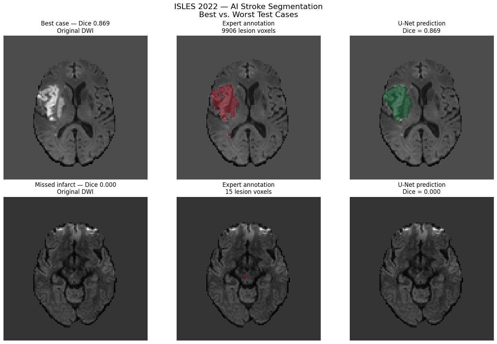

# Historical MRI segmentation examples

These are actual MRI images and predictions saved by the existing experiment,
extracted unchanged from the notebook. No new images, predictions, metrics,
training runs or threshold choices were generated for this gallery.

**Caption.** Historical internal-test examples from ISLES 2022. Top row:
`sub-strokecase0237`, a successful segmentation (full-volume Dice **0.869**).
Bottom row: `sub-strokecase0115`, a missed small lesion (full-volume Dice
**0.000**, 15 expert-labeled voxels and no predicted lesion). Columns show
normalized DWI, expert annotation over DWI in red, and U-Net prediction over DWI
in green. The background labeled “Original DWI” in the saved image is the
preprocessed, normalized DWI, not an untouched scanner-intensity image.

The historical figure code loads the best saved checkpoint, identified as
epoch **43** by saved evaluation output, and uses threshold **0.25**. For each
patient it displays the slice with maximum expert lesion area along voxel axis
2, rotated identically across panels. Numerical slice indices are not recorded;
this is not evidence of standardized anatomical orientation. Dice and voxel
counts refer to the **whole 3D volume**, not just the displayed slice. The model
uses DWI/ADC/FLAIR; only DWI is the displayed background.

The original “Best vs. Worst Test Cases” title is preserved in these historical
pixels. Interpret this as an illustrative success/failure comparison. Case 0237
has the highest Dice among the lesion-positive cases shown in the saved ranking;
0115 is one of multiple zero-Dice failures. The saved ranking also includes a
both-empty patient with Dice 1.0, which is not successful infarct delineation.
These selected examples do not characterize clinical reliability or establish
external validation. Case 0115 illustrates small-lesion failure; voxel count is
not physical infarct volume in mL.

## Figure inventory and numerical checks

| Example | Source | Expert voxels | Predicted voxels | Intersection | Full-volume Dice | Evidence status |
| --- | --- | --- | --- | --- | --- | --- |
| Successful case 0237 | Saved notebook cell 47, top row; cell 46 metric listing | 9,906 | 10,796 | 8,996 | 0.869095 in listing; 0.869 in image | Figure visually inspected; Dice independently recalculated from saved counts |
| Missed lesion 0115 | Saved notebook cell 47, bottom row; cell 46 metric listing | 15 | 0 | 0 | 0.000000 | Figure visually inspected; zero prediction and Dice checked against saved counts |

For 0237, `2 * 8996 / (9906 + 10796) = 0.8690947734518404`, matching
the six-decimal listing and three-decimal image label. For 0115 the numerator is
zero and denominator is 15, giving Dice zero. This verifies arithmetic and
caption consistency with available records, not independent MRI inference or
segmentation accuracy against newly inspected voxel arrays.

Source: [notebook at portfolio baseline c39a2ec](https://github.com/sbmedtech/isles2022-stroke-mri-segmentation/blob/c39a2ec9b525ad52b9c9a602b8caae554017c584/ISLES_2022_First_Colab_Notebook.ipynb),
zero-based cell **47**, Step 18, `display_data` → `image/png`. The same image is
present in the original [notebook commit 6df57ea](https://github.com/sbmedtech/isles2022-stroke-mri-segmentation/blob/6df57ea3591a7c58b7d3501880c7dae8eb270d16/ISLES_2022_First_Colab_Notebook.ipynb).
The original code records these two patient IDs and threshold 0.25; later
notebook source was repaired while its saved historical images remained unchanged.
Do not treat the saved PNG as output of rerunning the repaired source.

Extracted image: `assets/portfolio/historical-test-examples.png`, **83,395 bytes**,
SHA-256 `a7382a2d2ba6578bd42ac87e23ee4763c4160de888512350faf7465181f9cc76`.
The asset bytes match the decoded PNG in both source revisions. No cropping,
recoloring, added pixel labels or other image edits were applied. No identifying
names, dates or clinical identifiers are visible; patient references are dataset
case IDs. Original raw scans are not included.

## Results and verification status

| Result or check | Value / conclusion | Status |
| --- | --- | --- |
| Historical internal-test population | 38 total; 37 expert-positive, one expert-empty | Saved notebook output; exact split file not independently inspected |
| Historical positive-case mean / median Dice | **0.5377 / 0.5818** across 37 positive patients | Historical outputs; not independently recomputed from all 38 records by this reviewer |
| Historical positive patients with empty predictions | 2 of 37 | Saved output; empty predictions do not include every zero-overlap failure |
| Owner's independent reproduction | Owner reports exact Dice and voxel-count matches for all 38 cases | Owner-reported execution; original/reproduction comparison files not yet inspected |
| Actual released checkpoint | SHA-256 matches GitHub; epoch metadata 43; strict documented U-Net loading and finite synthetic forward pass | Independently checked checkpoint compatibility, not new real-MRI performance evidence |
| Checkpoint history | 43 loss entries match displayed historical losses at four decimals; optimizer step count agrees with documented schedule plus diagnostic update | Independently checked consistency, not complete training-lineage proof |
| Threshold 0.25 | Historical validation sweep reports selection at epoch 23 and subsequent retention | Documentary support; epoch-23 checkpoint/sweep association unresolved |
| Clinical/external performance | Not established | No external validation or clinical-readiness claim |

The released checkpoint SHA-256 is
`dd6ae8182a9af708662ad43e460459ef3deb3f89e70cc585ee9750d91755b70d`.
Its stored metadata does not include threshold/selection provenance or the actual
split, original source/environment or RNG identities. The saved gallery cannot
establish that its original checkpoint bytes equal the later uploaded bytes.
These unresolved details do not prevent honest display of historical figures;
they do limit claims about reproducibility and training/selection lineage.
Detailed investigation remains separate in [PR #18](https://github.com/sbmedtech/isles2022-stroke-mri-segmentation/pull/18).

## Attribution, figure rights and use

MRI and expert annotation source: **Hernandez Petzsche et al., ISLES 2022**,
[official Zenodo record 7960856](https://zenodo.org/records/7960856),
[Scientific Data paper (2022)](https://doi.org/10.1038/s41597-022-01875-5).
The official record's metadata, checked on 2026-10-13, declares
[Creative Commons Attribution 4.0](https://creativecommons.org/licenses/by/4.0/)
and describes skull-stripping for de-identification. Credit the ISLES dataset
authors for the underlying MRI/annotations and this repository's experiment for
the normalized-DWI visualization, overlays and model predictions. The PNG is
an unchanged extraction of that existing derived figure; transformations used
to create the historical figure are described above. No endorsement is implied.

The current dataset record also requests citation of de la Rosa et al.,
*DeepISLES: a clinically validated ischemic stroke segmentation model from the
ISLES'22 challenge*, Nature Communications 16, 7357 (2025). That work is a
separate model; its clinical validation does not apply to this project's U-Net.

A software MIT license does not replace dataset/derived-figure attribution or
establish a weight license. Independent reviewers should inspect this image,
attribution and source mapping before owner-approved merging. The existing
notebook is the figure evidence; a fresh inference provenance manifest is not
invented for it.

## Optional Google Drive inputs

Original figures were accessible, so no Drive upload is needed for this
success/failure gallery. For higher-resolution or additional cases, provide
`ISLES2022_Project/results/all_test_patient_visualizations.pdf` and, if saved,
the Step 18 success/failure PNG, together with
`ISLES2022_Project/results/test_epoch43.csv`. For figures from the repaired
workflow, provide `results/runs/<run-id>/epoch<epoch>-<provenance-digest>/example_test_patients.png`
and its `.png.manifest.json`, corresponding `test.csv` and
`test.csv.manifest.json`. Do not rename old figures as repaired-run results.
Exact full-cohort metric checking needs original and reproduction 38-row CSVs
and their comparison log; these can be supplied separately from large weights.
